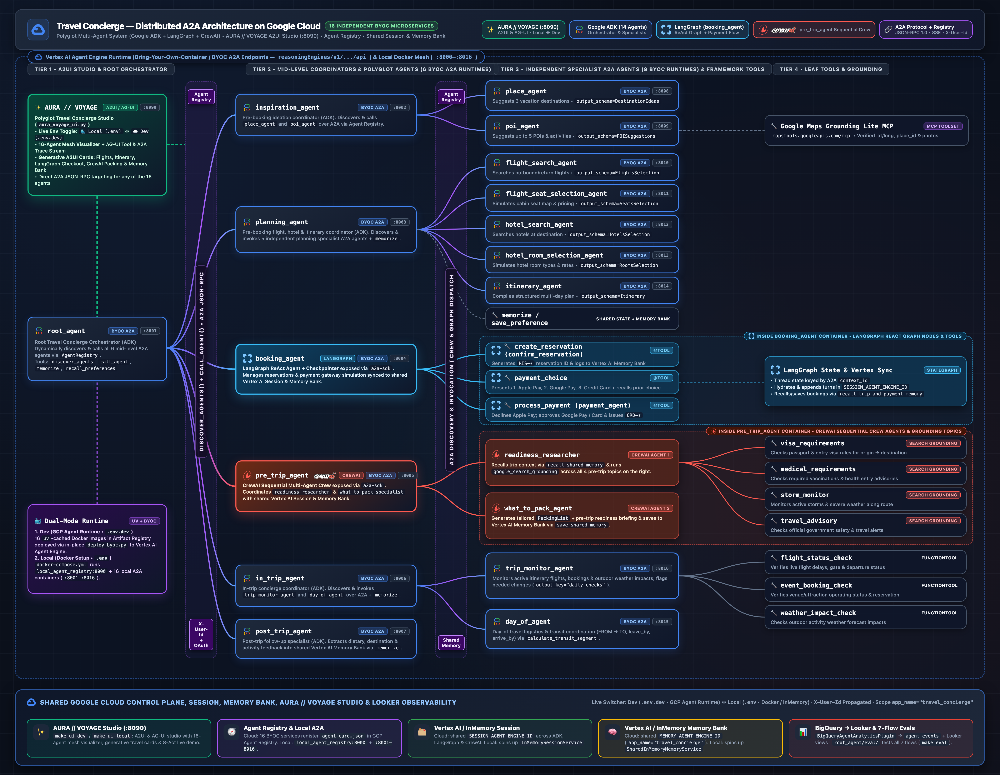

# Travel Concierge — Distributed Polyglot A2A Architecture (ADK + LangGraph + CrewAI)



This project implements the **Travel Concierge** ecosystem as **16 independently deployable Bring-Your-Own-Container (BYOC) A2A microservices** powered by `gemini-3-flash-preview` (on the Vertex AI `global` endpoint), dynamically discovered via **Agent Registry search** (`_registry.search_agents(search_string=capability, search_type="KEYWORD")` + `_registry.get_remote_a2a_agent(...)`).

It supports two strictly separated execution modes:
1. **Local Stateless Mode (`.env`, `LOCAL_MODE=true`)**: Runs locally (in Docker via [`docker-compose.yml`](./docker-compose.yml) or on your host via [`run_local.py`](./run_local.py)) using `InMemorySessionService`, `SharedInMemoryMemoryService` (`InMemoryMemoryService`), and the local Agent Registry v1 Emulator ([`local_agent_registry.py`](./local_agent_registry.py)). **Except for the Gemini model call, agents make zero connections to your GCP project in local mode** (`OTEL_TO_CLOUD=false`, `BQ_ANALYTICS_ENABLED=false`).
2. **Vertex AI Agent Runtime Cloud Mode (`.env.dev`, `LOCAL_MODE=false`)**: Deploys each agent as a BYOC A2A service on **Vertex AI Agent Engine**, registers its `AgentCard` in **Google Cloud Agent Registry**, shares a unified **Vertex AI Session Service** (`SESSION_AGENT_ENGINE_ID`) and **Vertex AI Memory Bank** (`MEMORY_AGENT_ENGINE_ID`), exports OpenTelemetry traces to **Google Cloud Trace** (`OTEL_TO_CLOUD=true`), and streams analytics events to **BigQuery** (`BQ_ANALYTICS_ENABLED=true`) for the **Looker Marketplace Agent Analytics Block**.

---

## 1. Polyglot Agent Topology (16 A2A Microservices)

| # | Folder | Agent Name | Framework | Port | Role |
|---|---|---|---|---|---|
| 1 | `root_agent/` | `root_agent` | **Google ADK** | `8001` | Root Travel Concierge orchestrator (`discover_agents` + `call_agent` across all 6 mid-level agents) |
| 2 | `inspiration_agent/` | `inspiration_agent` | **Google ADK** | `8002` | Pre-booking inspiration coordinator (`place_agent`, `poi_agent`) |
| 3 | `planning_agent/` | `planning_agent` | **Google ADK** | `8003` | Trip planning coordinator (`flight_search_agent`, `flight_seat_selection_agent`, `hotel_search_agent`, `hotel_room_selection_agent`, `itinerary_agent`) |
| 4 | `booking_agent/` | `booking_agent` | **LangGraph** | `8004` | Reservations & payment gateway ReAct graph (`create_reservation`, `payment_choice`, `process_payment`) |
| 5 | `pre_trip_agent/` | `pre_trip_agent` | **CrewAI** | `8005` | Sequential Crew (`readiness_researcher` + `what_to_pack_agent`) with `google_search_grounding` across visa, medical, storm & travel advisories |
| 6 | `in_trip_agent/` | `in_trip_agent` | **Google ADK** | `8006` | Active trip concierge coordinator (`trip_monitor_agent`, `day_of_agent`) |
| 7 | `post_trip_agent/` | `post_trip_agent` | **Google ADK** | `8007` | Post-trip feedback & preference extraction into shared Memory Bank |
| 8 | `place_agent/` | `place_agent` | **Google ADK** | `8008` | Destination ideas specialist (`output_schema=DestinationIdeas`) |
| 9 | `poi_agent/` | `poi_agent` | **Google ADK** | `8009` | Points of interest specialist (`output_schema=POISuggestions` + Google Maps Grounding Lite MCP) |
| 10 | `flight_search_agent/` | `flight_search_agent` | **Google ADK** | `8010` | Flight search specialist (`output_schema=FlightsSelection`) |
| 11 | `flight_seat_selection_agent/` | `flight_seat_selection_agent` | **Google ADK** | `8011` | Cabin seat map & seat selection specialist (`output_schema=SeatsSelection`) |
| 12 | `hotel_search_agent/` | `hotel_search_agent` | **Google ADK** | `8012` | Hotel search specialist (`output_schema=HotelsSelection`) |
| 13 | `hotel_room_selection_agent/` | `hotel_room_selection_agent` | **Google ADK** | `8013` | Hotel room selection specialist (`output_schema=RoomsSelection`) |
| 14 | `itinerary_agent/` | `itinerary_agent` | **Google ADK** | `8014` | Full multi-day itinerary compiler (`output_schema=Itinerary`) |
| 15 | `day_of_agent/` | `day_of_agent` | **Google ADK** | `8015` | Day-of transit logistics specialist (`calculate_transit_segment`) |
| 16 | `trip_monitor_agent/` | `trip_monitor_agent` | **Google ADK** | `8016` | Flight status, event booking & weather impact monitor (`flight_status_check`, `event_booking_check`, `weather_impact_check`) |

---

## 2. Environment Configuration (`.env` vs `.env.dev`)

Both `.env` and `.env.dev` are git-ignored via [`.gitignore`](./.gitignore) and excluded from Cloud Build uploads via `.gcloudignore`. Use the committed template files to initialize your local copies:

```bash
# 1. Local Stateless Mode config (InMemorySessionService + InMemoryMemoryService)
cp .env.example .env

# 2. Cloud Vertex AI Agent Runtime config (VertexAiSessionService + VertexAiMemoryBankService + Cloud Trace + BigQuery)
cp .env.dev.example .env.dev
```

- **`.env` (Local Mode)**: Sets `LOCAL_MODE=true`, `OTEL_TO_CLOUD=false`, `BQ_ANALYTICS_ENABLED=false`, `GOOGLE_CLOUD_LOCATION=global`, and `GENAI_MODEL=gemini-3-flash-preview`. Contains **no** `SESSION_AGENT_ENGINE_ID` or `MEMORY_AGENT_ENGINE_ID`.
- **`.env.dev` (Cloud Agent Runtime Mode)**: Loaded by `deploy_byoc.py` and `delete_byoc.py`. Sets `LOCAL_MODE=false`, `GOOGLE_CLOUD_LOCATION=global`, `VERTEX_ENGINE_LOCATION=us-central1`, `SESSION_AGENT_ENGINE_ID`, `MEMORY_AGENT_ENGINE_ID`, `OTEL_TO_CLOUD=true`, and `BQ_ANALYTICS_ENABLED=true`.

---

## 3. Running Locally (Stateless In-Memory Mode)

Authenticate Application Default Credentials for the `gemini-3-flash-preview` model call and install dependencies using `uv`:
```bash
gcloud auth application-default login
make setup   # runs: uv venv --allow-existing --python 3.12 .venv && uv pip install --python .venv/bin/python -r requirements.txt
```

### Option A: Local Docker Containers (`make docker-up`)
Builds a single shared image ([`Dockerfile.local`](./Dockerfile.local)) and starts **17 containers** (`tc-local-agent-registry` on `:8000` + all 16 A2A agents on `:8001`–`:8016`):
```bash
# Build shared image and start all 17 containers
make docker-up

# Verify Agent Cards and Local Agent Registry v1 search
curl -s http://localhost:8001/.well-known/agent.json | python3 -m json.tool
curl -s http://localhost:8004/.well-known/agent.json | python3 -m json.tool
curl -s http://localhost:8005/.well-known/agent.json | python3 -m json.tool
curl -s -X POST "http://localhost:8000/v1/projects/local/locations/global/agents:search" \
  -H "Content-Type: application/json" \
  -d '{"searchString": "booking", "searchType": "KEYWORD"}' | python3 -m json.tool

# Stop all containers
make docker-down
```

### Option B: Interactive Terminal CLI (`make run-local`)
```bash
# Launch interactive Traveler/Concierge chat (InMemorySessionService + SharedInMemoryMemoryService)
make run-local

# Or send a single query directly via uv
uv run python run_local.py --query "Inspire me about a trip to Cusco and Machu Picchu"

# Or start all 16 A2A uvicorn processes on host ports 8001..8016
make run-local-a2a
```

### Option C: **AURA // VOYAGE** — Polyglot A2UI & AG-UI Studio (`make ui`)
Because BYOC containers deploy with `agent_framework="custom"`, the Google Cloud Console Playground tab is disabled. **AURA // VOYAGE** ([`aura_voyage_ui.py`](./aura_voyage_ui.py)) provides a dedicated **A2UI (Agent-to-UI) & AG-UI (Agentic Generative UI)** web studio on `http://127.0.0.1:8090`:
- **Live 16-Agent Polyglot Mesh Visualizer**: Shows all 16 A2A agents grouped by tier and framework (`Google ADK`, `LangGraph`, `CrewAI`), their live Vertex AI Reasoning Engine IDs or local Docker ports (`:8001`–`:8016`), and pulses active nodes as `discover_agents` and `call_agent` execute.
- **Generative A2UI Widgets**: Renders interactive Destination & POI cards, Flight Boarding Passes, Luxury Hotel & 4-Day Itinerary timelines, **LangGraph Checkout Cards** (Apple Pay decline → Google Pay retry), **CrewAI Pre-Trip Packing Checklists**, In-Trip Flight/Transit Monitors, and **Memory Bank** preference cards.
- **Live Environment Switcher in the Header**: Toggle seamlessly between:
  - `🐳 Local (Docker Setup • .env)` — points to your local Docker Compose A2A mesh (`:8000` Local Agent Registry + `:8001`–`:8016` containers) or local `InMemorySessionService` + `SharedInMemoryMemoryService`.
  - `☁️ Dev (GCP Agent Runtime • .env.dev)` — points to the 16 deployed BYOC A2A agents on Vertex AI Agent Engine, Google Cloud Agent Registry, shared Vertex AI Session & Memory Bank engines, Cloud Trace, and BigQuery.
- **Target Any Agent Directly**: Select `Root Concierge (Full 16-Agent Mesh)` or send A2A JSON-RPC `message/send` requests directly to any individual agent (e.g., `booking_agent` LangGraph or `pre_trip_agent` CrewAI), plus one-click buttons for all **8 Live Demo Acts**.
```bash
make ui          # Start on http://127.0.0.1:8090 (defaults to Dev / GCP Agent Runtime)
make ui-local    # Start on http://127.0.0.1:8090 (defaults to Local Docker Setup)
make ui-dev      # Start on http://127.0.0.1:8090 (defaults to Dev / GCP Agent Runtime)
```

---

## 4. Native Google ADK Evaluations (`make eval` & `make adk-eval`)

The evaluation suite in [`root_agent/eval/`](./root_agent/eval/) uses **Google ADK's built-in evaluation framework** (`adk eval` CLI and `google.adk.evaluation.AgentEvaluator`) with [`test_config.json`](./root_agent/eval/data/test_config.json) (`tool_trajectory_avg_score` and `response_match_score`) across all 7 flows of `root_concierge_agent`:

| Flow | EvalSet File | Tested Capability & Agent Registry Search Trajectory |
|---|---|---|
| **Flow 1: Inspiration** | [`inspire.test.json`](./root_agent/eval/data/inspire.test.json) | `discover_agents("inspiration_agent")` → `call_agent(".../agents/inspiration_agent", ...)` for destination ideas & POIs |
| **Flow 2: Planning** | [`planning.test.json`](./root_agent/eval/data/planning.test.json) | `discover_agents("planning_agent")` → `call_agent(".../agents/planning_agent", ...)` → `memorize(...)` for flights, seats, hotel, room & itinerary |
| **Flow 3: Booking (LangGraph)** | [`booking.test.json`](./root_agent/eval/data/booking.test.json) | `discover_agents("booking_agent")` → `call_agent(".../agents/booking_agent", ...)` for `RES-*` reservations, payment choices & `ORD-*` payment processing |
| **Flow 4: Pre-Trip (CrewAI)** | [`pretrip.test.json`](./root_agent/eval/data/pretrip.test.json) | `discover_agents("pre_trip_agent")` → `call_agent(".../agents/pre_trip_agent", ...)` for visa, medical, storm alerts, travel advisories & packing list |
| **Flow 5: In-Trip** | [`intrip.test.json`](./root_agent/eval/data/intrip.test.json) | `discover_agents("in_trip_agent")` → `call_agent(".../agents/in_trip_agent", ...)` for flight/event/weather monitoring & day-of transit routing |
| **Flow 6: Post-Trip** | [`posttrip.test.json`](./root_agent/eval/data/posttrip.test.json) | `discover_agents("post_trip_agent")` → `call_agent(".../agents/post_trip_agent", ...)` for post-trip feedback & preference extraction |
| **Flow 7: Memory Bank** | [`memory_preferences.test.json`](./root_agent/eval/data/memory_preferences.test.json) | `save_preference(...)` → `memorize(...)` → `recall_preferences(...)` across shared Memory Bank |

```bash
# 1. Run deterministic 7-flow trajectory & Agent Registry search evaluation suite:
make eval

# 2. Run native `adk eval` CLI across all 7 .test.json EvalSets:
make adk-eval

# 3. Run live Gemini LLM evaluations via ADK AgentEvaluator across all 7 .test.json EvalSets:
make eval-live
```

---

## 5. Deploying to Vertex AI Agent Engine (Cloud Agent Runtime)

### Step 1: Enable GCP APIs & Create Artifact Registry Repository (One-Time)
```bash
export PROJECT_ID=$(grep ^GOOGLE_CLOUD_PROJECT= .env.dev | cut -d= -f2)

gcloud services enable \
  aiplatform.googleapis.com \
  cloudbuild.googleapis.com \
  artifactregistry.googleapis.com \
  agentregistry.googleapis.com \
  cloudtrace.googleapis.com \
  telemetry.googleapis.com \
  bigquery.googleapis.com \
  --project="$PROJECT_ID"

gcloud artifacts repositories create travel-concierge-agents \
  --repository-format=docker \
  --location=us-central1 \
  --description="Travel Concierge 16 A2A BYOC Agents" \
  --project="$PROJECT_ID" || true

PROJECT_NUM=$(gcloud projects describe "$PROJECT_ID" --format="value(projectNumber)")

# Grant Cloud Build write access to push images & Vertex AI Agent Engine read access to pull images:
gcloud artifacts repositories add-iam-policy-binding travel-concierge-agents \
  --location=us-central1 --project="$PROJECT_ID" \
  --member="serviceAccount:${PROJECT_NUM}-compute@developer.gserviceaccount.com" \
  --role="roles/artifactregistry.writer"

gcloud artifacts repositories add-iam-policy-binding travel-concierge-agents \
  --location=us-central1 --project="$PROJECT_ID" \
  --member="serviceAccount:service-${PROJECT_NUM}@gcp-sa-aiplatform-re.iam.gserviceaccount.com" \
  --role="roles/artifactregistry.reader"
```

### Step 2: Create or Update Shared Vertex AI Session & Memory Bank Engines
Creates (or updates in-place if already existing by `display_name`) the shared Session Service (`travel-concierge-shared-state`) and Memory Bank (`travel-concierge-memory-bank`) Reasoning Engines:
```bash
make create-shared-engines
# Save the printed SESSION_AGENT_ENGINE_ID and MEMORY_AGENT_ENGINE_ID in .env.dev
```

### Step 3: Provision BigQuery Dataset, Table & Looker Agent Analytics Views (One-Time)
Provisions `<GOOGLE_CLOUD_PROJECT>.agent_analytics.agent_events` and all Looker views (`v_llm_request`, `v_llm_response`, `v_tool_starting`, `v_tool_completed`, `v_agent_starting`, `v_agent_completed`, `v_user_message_received`, `v_polyglot_agent_metrics`) for the [Looker Marketplace Agent Analytics Block](https://marketplace.looker.com/marketplace/detail/agent_analytics):
```bash
make setup-bigquery
```

### Step 4: Build & Push All 16 Container Images to Artifact Registry
Each agent's `Dockerfile` uses `uv` (`COPY --from=ghcr.io/astral-sh/uv:latest /uv /bin/uv`) and layer caching (`COPY requirements.txt .` before `COPY . .`) for fast builds. `make build-images-all` rebuilds and pushes all 16 images in parallel (or pass `SKIP_EXISTING=true` to only build missing images) and prints a 16-agent verification report at completion:
```bash
# Build and push all 16 container images to Artifact Registry:
make build-images-all

# Skip images already present in Artifact Registry:
make build-images-all SKIP_EXISTING=true
```

### Step 5: Deploy or Update All 16 BYOC A2A Agents & Verify Status
Verifies that each agent's container image exists in Artifact Registry, deploys each BYOC container to **Vertex AI Agent Engine** (automatically updating existing Reasoning Engines in-place by `AGENT_ENGINE_RESOURCE_NAME` or `display_name` rather than creating duplicates), registers its `AgentCard` in **Google Cloud Agent Registry**, and prints a full 16-agent verification table:
```bash
make deploy-all

# Force in-place update of all 16 deployed Agent Engines:
make deploy-all FORCE_DEPLOY=true

# Run the 16-agent verification report at any time:
make verify-deployment

# Tear down all deployed Agent Engine instances when finished:
make delete-all
```